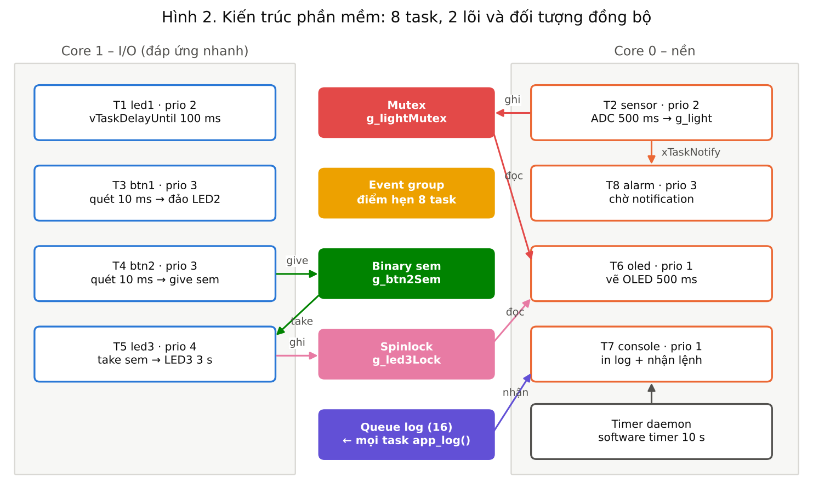

# Project cá nhân (70%) – FreeRTOS trên ESP32-S3

Sinh viên: **Đặng Đình Mạnh** – MSSV **24119055** · GVHD: Huỳnh Hoàng Hà
Báo cáo: [`../03_Reports/Report_Project_CaNhan_FreeRTOS_24119055.pdf`](../03_Reports/Report_Project_CaNhan_FreeRTOS_24119055.pdf)



## Phần cứng (ESP32-S3 DevKitC-1)

| Linh kiện | ESP32-S3 | ESP32 thường (env esp32dev) |
|---|---|---|
| LED1 / LED2 / LED3 (+220 Ω) | GPIO12 / 13 / 14 | GPIO19 / 18 / 5 |
| BTN1 / BTN2 (nối GND, pull-up trong) | GPIO16 / 17 | GPIO4 / 13 |
| Module quang trở (AO) | GPIO2 (ADC1_CH1) | GPIO35 |
| OLED SSD1306 I2C 0x3C | SDA 41, SCL 42 | SDA 21, SCL 22 |

Đổi chân trong `include/config.h`. Mạch chia áp quang trở tự ráp (LDR lên 3V3) thì đặt `LDR_INVERT 0`.

## Task

| Task | Core | Prio | Chu kỳ / sự kiện | Kỹ thuật |
|---|---|---|---|---|
| T1 led1 | 1 | 2 | 100 ms (T = 200 ms) | vTaskDelayUntil, pvParameters |
| T2 sensor | 0 | 2 | 500 ms | mutex, event group, xTaskNotify |
| T3 btn1 | 1 | 3 | quét 10 ms | chống dội, vTaskDelay |
| T4 btn2 | 1 | 3 | quét 10 ms | xSemaphoreGive (binary) |
| T5 led3 | 1 | 4 | chờ semaphore | xSemaphoreTake, critical section |
| T6 oled | 0 | 1 | 500 ms | mutex, critical section, xEventGroupWaitBits |
| T7 console | 0 | 1 | chờ queue | queue + gatekeeper, suspend/resume/prio, stack monitor |
| T8 alarm | 0 | 3 | chờ notification | xTaskNotifyWait |
| timer | daemon | – | 10 s | software timer auto-reload |

Mọi task gọi `xEventGroupSync` ở đầu nên cùng xuất phát. Mỗi kỹ thuật đánh dấu `[K1]`..`[K14]` trong code, bảng tra ở đầu `src/main.cpp`.

## Chạy

1. VS Code + PlatformIO, mở thư mục này, chọn env `esp32s3`. Build ✓ → Upload → → Serial Monitor 115200.
2. Gõ lệnh trong Serial Monitor: `help`, `stat`, `light`, `give`, `s 1` / `r 1` (dừng / chạy lại LED1), `p 6 2` (đổi priority Task 6).
3. Không có kit: F1 → *Wokwi: Start Simulator* (`diagram.json`).
4. Nạp sẵn không cần build: `prebuilt/firmware_esp32s3_factory.bin` ở địa chỉ 0x0 (ESP Web Flasher / esptool).

Ghi chú:
- Đường dẫn có dấu ("ĐỢT 2") làm ld trên Windows lỗi → `platformio.ini` build ra `C:\Users\<tên>\.pio_build\rtos_24119055`; `scripts/copy_fw.py` chép firmware về `.pio/wokwi/` cho Wokwi.
- Cắm cổng USB gốc (không phải cổng UART) thì đổi `-DARDUINO_USB_CDC_ON_BOOT=1`.
- Upload không vào: giữ BOOT, nhấn RST, thả BOOT rồi upload lại.

## Chạy giả lập QEMU (đã dùng để kiểm thử)

Env `qemu_esp32` (QEMU không có ADC nên Task 2 dùng tín hiệu giả `SIM_NO_ADC`; không nạp bản này lên kit):

```bash
pio run -e qemu_esp32
esptool.py --chip esp32 merge-bin -o flash.bin --fill-flash-size 4MB 0x1000 bootloader.bin 0x8000 partitions.bin 0xe000 boot_app0.bin 0x10000 firmware.bin
qemu-system-xtensa -machine esp32 -icount 3 -display none -serial stdio -drive file=flash.bin,if=mtd,format=raw
```

Kết quả: [`docs/qemu_log.txt`](docs/qemu_log.txt). LED3 sáng đúng 3000 ms; 3 lần `give` liên tiếp cho 2 lượt sáng (binary semaphore giữ tối đa 1 token); báo tối ở 22 %, hết tối ở 37 %; không log nào bị bỏ.

## Kiểm thử trên kit (điền khi chạy)

| # | Thao tác | Mong đợi | Kết quả |
|---|---|---|---|
| 1 | Cấp điện | LED1 nháy 5 lần/s, Serial có dòng `[T7] 8 task da qua diem hen` | |
| 2 | Nhấn BTN1 | LED2 đảo, OLED đổi ON/OFF | |
| 3 | Nhấn BTN2 | LED3 sáng 3 s, OLED đếm 3.0 → 0.0 → OFF | |
| 4 | Nhấn BTN2 3 lần nhanh | LED3 sáng 2 lượt; log "da co token" | |
| 5 | Che quang trở | % giảm; dưới 25 % OLED hiện [TOI] | |
| 6 | `s 1` rồi `r 1` | LED1 dừng rồi nháy lại | |
| 7 | `stat` sau 10 phút | stack còn dư, `drop 0` | |
